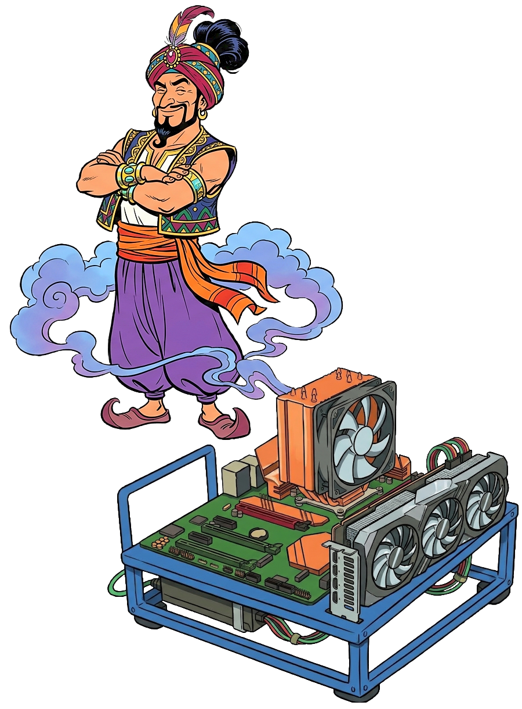

# Setting up a local agent

Prerequisites: a Windows machine with WSL.

# 1. A dedicated WSL instance `AgentHost`

```bash
wsl.exe --install -d Debian --name AgentHost
wsl.exe -d AgentHost
```

Remove its auto-mounts to enable `systemd` and disable interoperability.

```bash
sudo tee /etc/wsl.conf <<EOF
[boot]
systemd=true

[interop]
enabled=false
appendWindowsPath=false

[automount]
root = /
enabled = false
mountFsTab = false
EOF

sudo passwd -d $USER # remove user password
sudo apt update
sudo apt install ca-certificates curl jq fzf vim ripgrep fd-find

wsl.exe --terminate AgentHost # reboot
```


# 2. Share a directory

The personal WSL owns a workspace directory, which has this repository and the other repositories we want to work on.

Let's not use `/etc/fstab` because it prints this error when starting WSL:
> wsl: Processing /etc/fstab with mount -a failed.
Root cause: auto-mount fstab runs before `/wsl` is ready.

Let's not use systemd because its syntax is too verbose.

We will use `.profile` or `.bashrc` or `.bash_local`, choose what works for you.

## In the host: personal WSL

```bash
RCFILE=~/.profile # customize here
WORKSPACE=~/workspace/WorkspaceForAgents/ # customize here
DEST=/wsl/WorkspaceForAgents

mkdir -p $WORKSPACE
mkdir -p $DEST

cat >> $RCFILE << EOF

 # mount bind for sharing Agent Workspace
if ! mountpoint -q $DEST ; then
  sudo mount --bind $WORKSPACE $DEST
fi
EOF

source $RCFILE
```

## In the AgentHost WSL

### Mount the shared directory


```bash
WORKSPACE=/wsl/WorkspaceForAgents
DEST=/workspace
RCFILE=~/.profile

sudo mkdir -p $DEST

cat >> $RCFILE << EOF

 # mount bind for sharing Agent Workspace
if ! mountpoint -q $DEST; then
  sudo mount --bind $WORKSPACE $DEST
fi
EOF

source $RCFILE
```

### Clone this repository to access the automation scripts

```
cd /workspace
git clone https://github.com/NeptuneMagicSauce/LocalGenie.git
```

### Add this repository scripts to the PATH

```
cat >> ~/.profile << EOF
PATH=/workspace/LocalGenie/data/scripts:\$PATH
EOF
source ~/.profile
```

# 3. Docker

In the `AgentHost` WSL, install it with the [official instructions](https://docs.docker.com/engine/install/debian/#install-using-the-repository):

```bash
wsl.exe -d AgentHost

sudo curl -fsSL https://download.docker.com/linux/debian/gpg -o /etc/apt/keyrings/docker.asc

sudo tee /etc/apt/sources.list.d/docker.sources <<EOF
Types: deb
URIs: https://download.docker.com/linux/debian
Suites: $(. /etc/os-release && echo "$VERSION_CODENAME")
Components: stable
Architectures: $(dpkg --print-architecture)
Signed-By: /etc/apt/keyrings/docker.asc
EOF

sudo apt update

sudo apt install docker-ce docker-ce-cli containerd.io docker-buildx-plugin docker-compose-plugin

sudo groupadd docker
sudo usermod -aG docker $USER

wsl.exe --terminate AgentHost # reboot
wsl.exe -d AgentHost
```

make sure it works:

```bash
systemctl status docker
docker run hello-world
docker images
docker image rm $ID
```

# 4. nvidia-container-toolkit

In the `AgentHost` WSL, install it with the [official instructions](https://docs.nvidia.com/datacenter/cloud-native/container-toolkit/latest/install-guide.html#with-apt-ubuntu-debian):

```bash
curl -fsSL https://nvidia.github.io/libnvidia-container/gpgkey | sudo gpg --dearmor -o /usr/share/keyrings/nvidia-container-toolkit-keyring.gpg   && curl -s -L https://nvidia.github.io/libnvidia-container/experimental/deb/nvidia-container-toolkit.list |     sed 's#deb [^ ]* #&[signed-by=/usr/share/keyrings/nvidia-container-toolkit-keyring.gpg] #' |     sudo tee /etc/apt/sources.list.d/nvidia-container-toolkit.list

sudo apt update
sudo apt install nvidia-container-toolkit
sudo nvidia-ctk runtime configure --runtime=docker
sudo systemctl restart docker
```

Make sure it works:

```bash
docker run --rm --gpus all nvidia/cuda:12.0.0-base-ubuntu22.04 nvidia-smi
docker images
docker image rm $ID
```

# 5. Ollama

The inference server, installed in a docker container, in the `AgentHost` WSL:

```bash
genie_update_ollama
```

This script [genie_update_ollama](../scripts/genie_update_ollama) updates Ollama if needed, and sets it up as an always running daemon.

# 6. Start, Stop, release VRAM

## Start

```bash
wsl.exe -d AgentHost true
```

## Stop

```bash
wsl.exe --terminate AgentHost
```

## Release VRAM only

For gaming, without stopping everything.

From personal WSL:
```bash
wsl.exe -d AgentHost docker restart ollama
```

From `AgentHost` WSL:
```bash
docker restart ollama
```

# 7. Models

## Hugging Face CLI (optional)

for browsing

```bash
curl -LsSf https://hf.co/cli/install.sh | bash

hf models ls --num-parameters "min:6B,max:16B" --search "code" --sort downloads

hf models list Qwen/Qwen2.5-Coder-14B-Instruct-GGUF
```

## Install some models

For example:

```bash
ollama pull hf.co/mradermacher/Qwen3.8-14B-Instruct-Turbo-GGUF:Q4_K_M
ollama pull hf.co/unsloth/Devstral-Small-2-24B-Instruct-2512-GGUF:IQ4_XS
ollama pull hf.co/unsloth/Qwen3.8-27B-GGUF:UD-IQ3_S
```

# 8. Text editor

This portable build of `emacs` is 40 MB.

```bash
mkdir -p ~/tmp
cd ~/tmp
rm -fr EmacsPortableBuild
git clone https://github.com/NeptuneMagicSauce/EmacsPortableBuild.git
cd EmacsPortableBuild
./data/build.sh
rm -fr data/output
sudo tar xzf data/emacs.tgz -C /usr
cat >> ~/.profile << EOF
export EDITOR="emacs -l save.on.quit"
EOF
source ~/.profile
```

Alternative: `vim`. The choice will be propagated to the `OpenCode` container, for editing prompts.

```bash
cat >> ~/.profile << EOF
export EDITOR=vim
EOF
source ~/.profile
```


# 9. OpenCode

It is the agentic harness.

## Bare-Metal -> NO

Important security point: we are not installing the agentic harness in the personal WSL, nor in the Windows host. It belongs in the dedicated WSL instance, and then further isolated in a docker container.

The actual installation command is found in the `Dockerfile`.

Corollary: directly launching ollama through opencode or vice versa can not work when ollama and opencode are in different containers, they do not see each other.
```
ollama ollama launch opencode # can not work
```

## Containerized in a Docker container

In the `AgentHost` WSL.

Install and/or update:

```bash
genie_update_opencode
```

This script [genie_update_opencode](../scripts/genie_update_opencode) will run `docker build` on this [Dockerfile](../scripts/docker/opencode/Dockerfile), caching the base Debian system and updating OpenCode without caching.

Run it:
```bash
opencode
```

This script [opencode](../scripts/opencode) runs the OpenCode container, with mount-binds for the relevant directories: config/state/share and the workspace repositories.

## Auto-discover models

I can not get OpenCode to auto discover the local Ollama models.

## Helper script: update models

The script [genie_update_models](../scripts/genie_update_models) updates the list of models returned by Ollama, saves them into `opencode.json`. Run it after you change the list of models (`ollama pull`, `ollama rm`).

## Helper script: choose default model

The script [genie_choose_default_model](../scripts/genie_choose_default_model) prompts for the default model among the installed models, and saves it into `opencode.json`.

## Settings (optional)

These [settings](../settings/opencode.cli.json) are a good starting point: `permissions: autoaccept` makes sense if and only if the agent is sandboxed.

```bash
cp -vi \
  /workspace/LocalGenie/data/settings/opencode.cli.json \
  ~/.config/opencode/cli.json
```

# X. TODO

- [x] hide external providers
- [x] share an agentic-workspace dir between all
- [x] put some of this content in dedicated files, the content we need to re-run
- [x] after registering models, prompt for default with fzf
- [x] save favorite models, they are lost on container restart
  persist this: ~/.local/state/opencode
- [x] have an update method for opencode
- [x] have an update method for ollama
- [x] setting file ~/.config/opencode/cli.json is owned by root!
- [x] settings
- [x] have small emacs in both AgentHost and opencode container, set it as EDITOR
- [ ] zile is not great for editing prompts, no line-wrap: maybe emacs?
- [ ] image show in terminal (opencode) fails: find reproduction and fix
- [ ] maybe have opencode persist, same as ollama daemon, for faster restarts?
      but then: how should it be started from personal WSL?
- [ ] customize context size per model
- [ ] find a few models that fit in VRAM
- [ ] test the models with the prompt for the CatPi bug fix
- [ ] a dashboard: GUI app in host, showing loads
- [ ] hardening: try to escape the sandboxes
- [ ] rebuild my image processing filter with gemma
